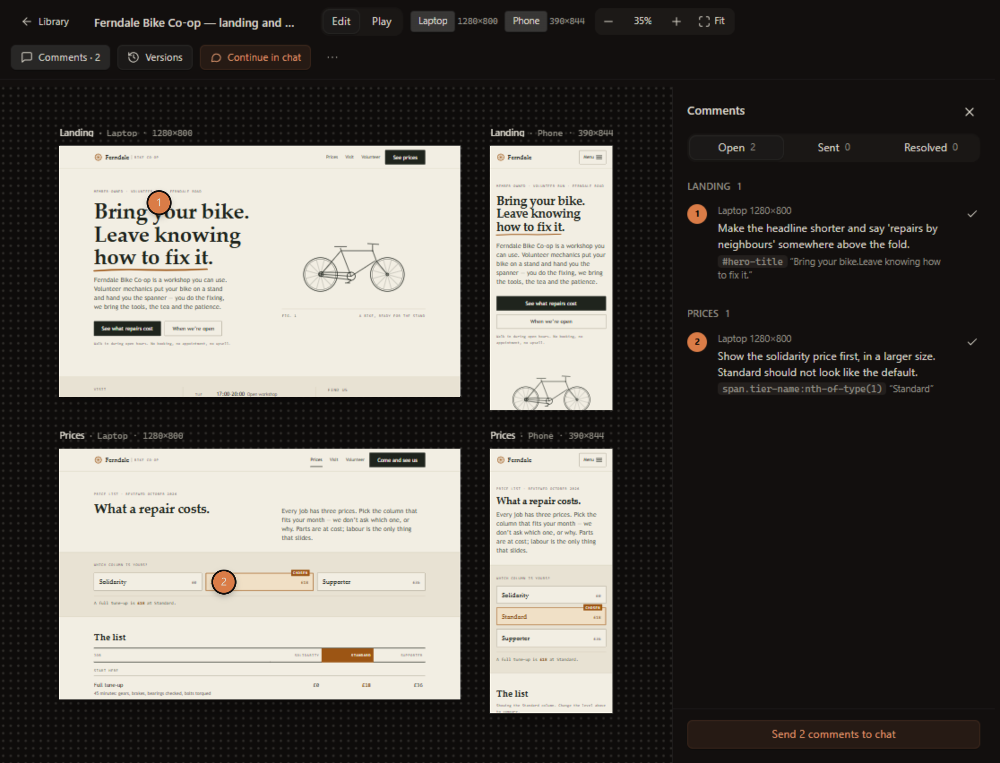
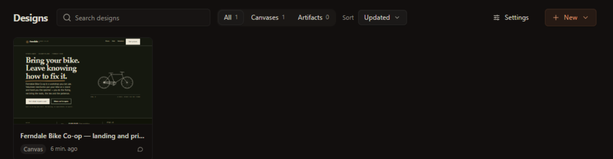
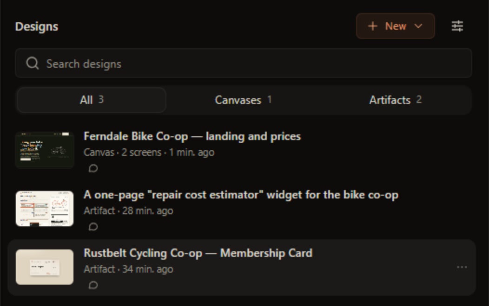
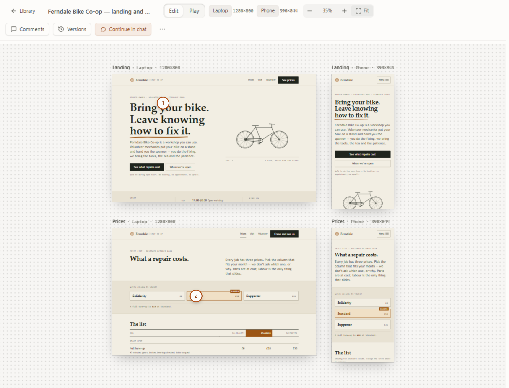
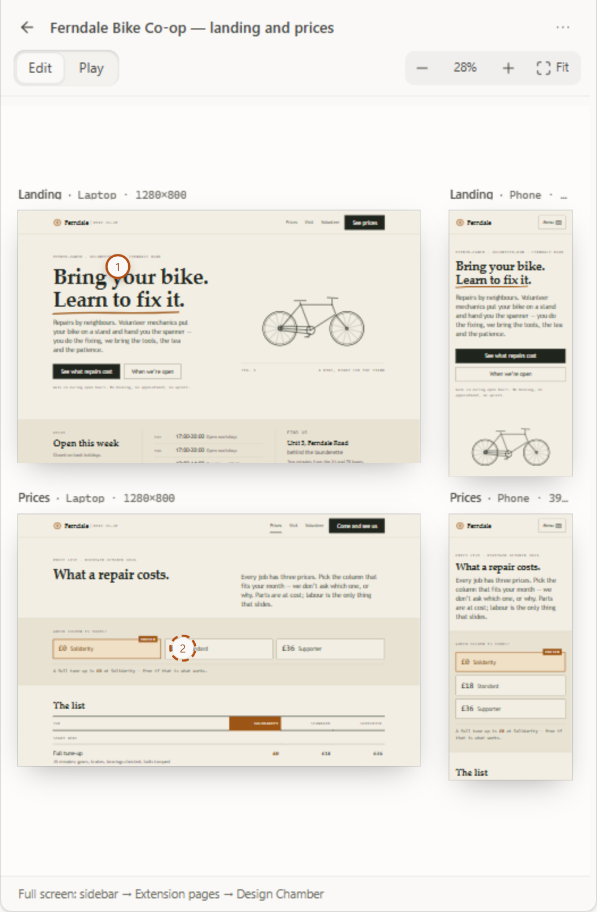
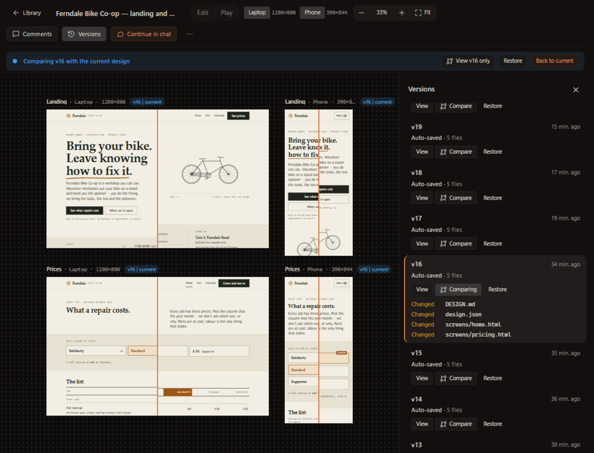
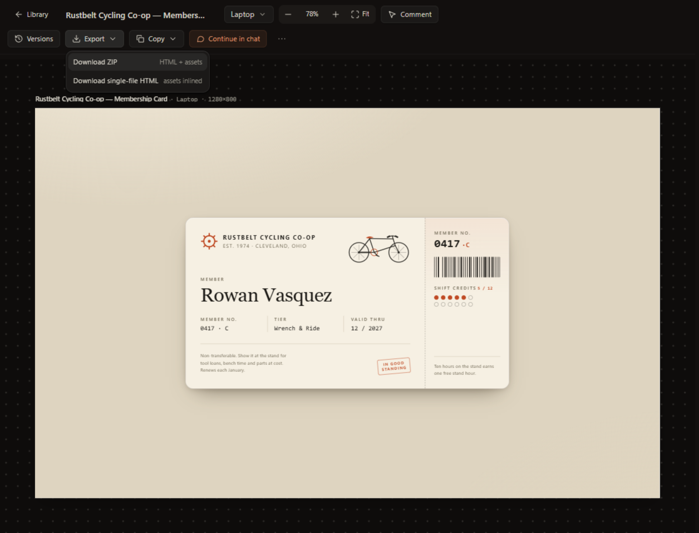
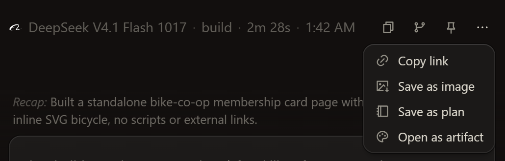
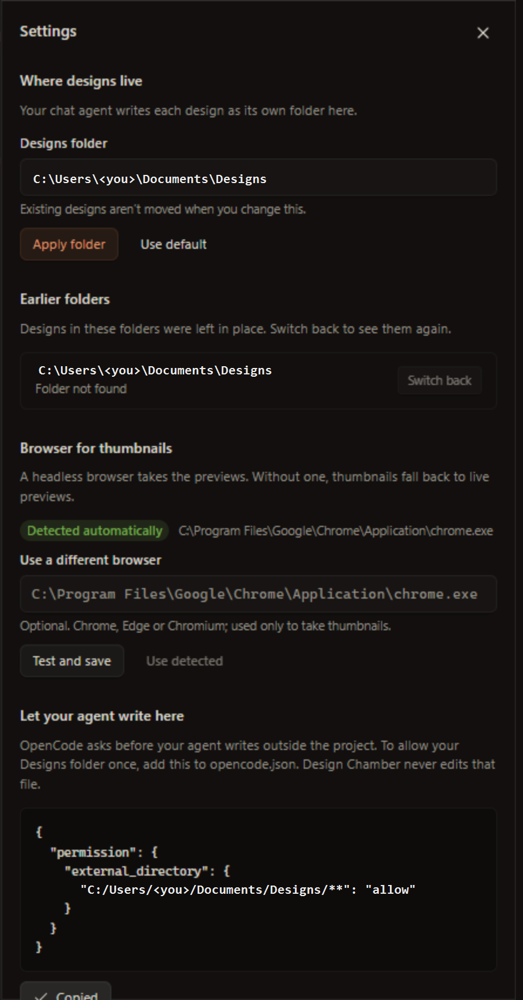

# Design Chamber

**Design canvases and HTML artifacts, inside OpenChamber.** Ask your own chat agent for a
design; it writes plain files to `~/Documents/Designs`; Design Chamber renders them live in a
rail panel and a full-screen page — with a pannable multi-screen wall, element-anchored comment
pins, version history and export.

[](LICENSE)
[](package.json)



## What it is

- A **Claude-Design-style canvas**: an infinite wall where every screen of a design sits next
  to every device size you care about (Laptop, Phone, …) as live artboards. Edit mode to pin
  comments, Play mode to click through the prototype.
- **Claude-artifacts-style HTML pages**: one self-contained page, rendered like a browser tab,
  exportable as a ZIP or a single HTML file.
- **Inside OpenChamber.** No external browser window, no dev server. A rail panel lists your
  designs; a full-screen page opens them. Colours follow your OpenChamber theme, light or dark.
- **Written by your own chat agent** — any model OpenChamber can run. Design Chamber doesn't
  generate anything; it gives your agent the rules (and a place to write) and shows the result.
- **Plain local files.** One folder per design under `~/Documents/Designs` (changeable). Open
  them in an editor, commit them to git, zip them.

## How it compares

Claude rows are "as of Oct 2026, from public docs"; `—` means no equivalent that I can point
to, and `?` means I couldn't confirm it. Corrections welcome.

| | **Design Chamber** | **Claude artifacts** (claude.ai) | **Claude Design** (Anthropic) |
|---|---|---|---|
| Where it runs | Inside OpenChamber (desktop app), local | In Claude's apps / claude.ai | Hosted by Anthropic |
| Who generates | **Your** chat agent — any model | Claude | Claude |
| Where the files live | Your disk: `~/Documents/Designs/<slug>/` | In the conversation / your Claude account | In the product |
| Multi-screen, multi-viewport canvas | ✅ screens × viewports wall, pan/zoom | — (one artifact) | ✅ multi-artboard canvas |
| Click-through prototype | ✅ Play mode | partial (the page's own JS runs) | ✅ |
| Element-anchored comments | ✅ pins on canvases **and** artifacts; send to chat as one revision request | — | ✅ pinned comments |
| Versions | ✅ auto + after each agent turn; view, compare (split), restore | ✅ per-artifact version selector | ? |
| Export | ZIP (HTML + assets) · single-file HTML | copy / download the code | PDF, image and others ? |
| Design system / project rules | Reads your project's `DESIGN.md`, tokens, `AGENTS.md`/`CLAUDE.md` first; 10 style presets; per-design `DESIGN.md` + `tokens.css` | — | Hosted design-system artifact |
| Works offline / private | ✅ loopback-only helper; designs never touch the network (only your chat model sees what you send it) | — hosted | — hosted |
| Theme | Follows OpenChamber's theme live | Claude's UI | Claude's UI |
| Model choice | Whatever your chat uses | Claude | Claude |
| Source / licence | Open source, MIT | Closed | Closed |

The difference in one sentence: Claude Design and artifacts generate *on Anthropic's surface*;
Design Chamber makes *your* agent design *on your machine*, as files you own.

## Quick start

**Requirements:** OpenChamber ≥ 2.5.0 · Windows, macOS or Linux · optional Chrome, Edge or
Chromium (for PNG thumbnails — without one, the library uses live previews).

1. **Install.** In OpenChamber open **Settings → Extensions** and add this folder:
   - *From source:* `npm install && npm run build`, then add the repo folder. (`dist/` is
     gitignored, so build first.)
   - *From a release zip:* `npm run build && npm run pack` makes `design-chamber-<version>.zip`
     if you'd rather install that.
2. **Approve the permissions** the extension asks for — it runs a small local helper (the
   "service") that reads and writes your designs folder and launches the browser for thumbnails.
3. **Start a design.** In any chat type:
   ```
   /design a landing page and price list for a volunteer bike co-op, laptop + phone
   ```
   Your agent reads your project's design rules, may ask a few questions, then writes the
   files. The design appears in the panel and starts rendering the moment its first file lands.
4. **Or just a page:** `/artifact a one-page repair-cost estimator widget`.
5. **Already have HTML in a chat?** On an assistant message that contains an HTML code block,
   use the **⋯** menu → **Open as artifact**. It's saved into Designs and opens in the viewer.
6. **Go full screen:** the rail viewer is compact; for the full library and wall use OpenChamber's
   **sidebar → Extension pages → Design Chamber**. (Extensions can't open their own full-screen
   page from code, so the rail points you there.)
7. **One-time permission setting** so your agent can write outside the project without asking
   each time — see [Let the agent write to Designs](#let-the-agent-write-to-designs).

## Using it well

**Writing a good brief.** Say what it is, who it's for, the main task, the tone, and the
screens you want — plus anything real you have (copy, logo, photos in the project). One or two
sentences is fine; the agent will ask for the rest. Briefs are capped at 2 000 characters.

**The agent reads your project first.** Before designing, it looks for your project's own rules —
`DESIGN.md`, token and theme files (`tokens.css`, Tailwind config, `:root` blocks), and the design
sections of `AGENTS.md` / `CLAUDE.md` — and follows them. Precedence, highest first:

1. what you say in chat
2. your project's design rules
3. the style preset you picked
4. this design's own `DESIGN.md` + `tokens.css` (once you've confirmed them)
5. the built-in anti-"generic AI look" rules

**It asks before it builds.** For anything open-ended the agent sends one message with 3–6
questions, each with a **bold recommended default**. Reply with changes, or say **go** to accept
the defaults. Say "go" (or "just do it") in your brief to skip the questions.

**Viewports.** Taken from your project's breakpoints when it has them; otherwise the agent asks,
recommending **Laptop 1280×800 + Phone 390×844**. Each screen × viewport becomes an artboard.

**Style presets.** Pick one in the New dialog (or let the agent offer directions): `editorial`,
`minimal-saas`, `brutalist`, `warm-craft`, `data-dense-dashboard`, `playful`, `luxury`,
`technical-mono`, `poster-print`, `nocturne`. Your project's own rules still outrank a preset.

**Canvas or artifact?** A **canvas** is a wall of several screens (a flow, a responsive set, two
directions) at one or more viewports. An **artifact** is one self-contained HTML page — a widget,
a landing page, a card. Use `/design` for the first, `/artifact` for the second.

**Commenting with pins.** In **Edit** mode click any element, write a note, and a numbered pin
is dropped on it (the element's selector and text travel with the comment, so it survives edits;
if the element moved or vanished the pin shows dashed and is listed under *Detached*). Pins work
on artifacts too. Open **Comments** and press **Send N comments to chat** — all of them go to the
design's linked chat as one revision request. Use **Play** to click through the prototype.

**Versions.** A snapshot is saved automatically after a quiet period and after each agent turn.
In **Versions** you can **View** an old one, **Compare** it with the current design (every artboard
splits version | current, with the list of changed files), or **Restore** it — the current state
is saved as a version first, so a restore is never destructive.

**Exports.** From an artifact: **Export → Download ZIP** (HTML + assets) or **Download
single-file HTML** (assets inlined). From a canvas: **⋯ → Export ZIP / Export screen as HTML**.
Files land in `~/Downloads` and a toast offers **Show in folder**. **Copy ▾** copies the HTML.

**Continue in chat.** Every design remembers the chat that made it. **Continue in chat** reopens
it (or starts a new one if the old chat is gone), so revisions stay in context.

**Delete** moves a design to `<designs folder>/.trash/` — never a hard delete.

### Let the agent write to Designs

OpenCode asks before an agent writes outside the project folder. To allow your Designs folder
once, add this to your `opencode.json` (**Settings → Let your agent write here** shows it with
your actual path and a Copy button; Design Chamber never edits your config):

```json
{
  "permission": {
    "external_directory": {
      "C:/Users/you/Documents/Designs/**": "allow"
    }
  }
}
```

### Change the Designs folder

**Settings (the sliders icon) → Designs folder → Apply folder.** Existing designs are *not*
moved; earlier folders are listed with **Switch back**. **Use default** returns to
`~/Documents/Designs`.

## Gallery

| | |
|---|---|
|  |  |
| **Library** (full-screen page, light theme): thumbnail cards, search, All / Canvases / Artifacts, sort. | **Rail list** (320–480 px, dark): the same designs, compact. |
|  |  |
| **The wall in Edit mode, light theme.** Screens are rows, viewports are columns; click an element to pin a comment. | **Compact viewer in the rail.** Same wall, fit to width; a dashed pin means its element moved. |
|  |  |
| **Versions → Compare.** Each artboard splits version vs. current; changed files are listed; Restore saves the current state first. | **Artifact viewer + Export menu**: ZIP or single-file HTML; Comment mode, Versions, Copy, Continue in chat. |
|  |  |
| **Open as artifact** on any assistant message with an HTML block. | **Settings**: designs folder, thumbnail browser, and the `opencode.json` snippet. |

## Keyboard shortcuts on the wall

| Key | Action |
|---|---|
| Wheel / trackpad over the background | Pan (both axes) |
| `Space` + drag · middle-drag · `H` | Pan tool (`H` toggles it) |
| Arrow keys | Nudge the view |
| `Ctrl`/`⌘` + wheel · pinch | Zoom around the cursor (5–400 %) |
| `+` / `−` | Zoom in / out |
| `Shift+0` | 100 % |
| `Shift+1` | Fit all |
| Double-click an artboard label | Focus that artboard |
| Click an element (Edit) | Open the comment composer on it |
| `Ctrl`/`⌘` + `Enter` · `Esc` | Add the comment · cancel / close popovers and drawers |

## On disk

```text
~/Documents/Designs/
└── <slug>/                  one folder per design (slug: lowercase letters, digits, hyphens)
    ├── design.json          kind ("artifact" | "canvas"), title, dates, linked chat,
    │                        viewports, screens, comments
    ├── index.html           artifact entry page
    ├── screens/<id>.html    canvas screens (one file per screen)
    ├── assets/              images, fonts, CSS, scripts the pages use (relative paths)
    ├── DESIGN.md            this design's design system, in words
    ├── tokens.css           …and as CSS variables
    ├── .versions/           snapshots (content-addressed, newest 100 kept)
    └── .chamber/            Design Chamber's own state and the agent's RULES.md — not exported
```

`.trash/` and `.exports/` at the root hold deleted designs and an export fallback. Fonts go in
`assets/` — designs can't load Google Fonts or CDNs (see below). The exact schema is in
[`docs/SPEC.md`](docs/SPEC.md) §6.

## Privacy and security

- The helper service listens on **127.0.0.1 only** and requires a **bearer token** on every
  request; panels never see the token.
- **Agent-written HTML is untrusted.** It renders only in sandboxed iframes (never
  `allow-scripts` together with `allow-same-origin`), cut off from the host and from the token.
- **Designs get no network.** Remote scripts, web fonts and remote images are blocked — that's
  what the "N remote" badge and the artifact banner tell you. Local files and inline JS work.
- Every path is resolved and checked to stay **inside the Designs folder** before use.
- Nothing leaves your machine except what *your chat model* sees (your brief, comments you send,
  the files your agent reads). Design Chamber itself uploads nothing.
- It never edits your OpenCode/OpenChamber config.

## Troubleshooting

| Symptom | Fix |
|---|---|
| Cards show a live preview instead of a PNG thumbnail | No Chrome, Edge or Chromium was found. **Settings → Browser for thumbnails → Use a different browser** → paste the path → **Test and save**. |
| The agent asks permission every time it writes a file | Add the `external_directory` snippet from [Let the agent write to Designs](#let-the-agent-write-to-designs) to your `opencode.json`. |
| An artboard says *screens/x.html not written yet* | `design.json` lists a screen the agent hasn't written (or has misnamed). It appears the moment the file lands; if not, ask the agent to finish or fix the screen file. |
| A design looks unstyled / images or fonts missing, or a "N remote" badge appears | The page references a CDN, web font or remote image — blocked by design. Ask the agent to inline the CSS and put fonts and images in `assets/` with relative paths. |
| My designs vanished | The Designs folder was changed. **Settings → Earlier folders → Switch back.** |
| A design I created by hand isn't listed | A folder needs `design.json` (or at least an `index.html`, shown as an artifact with a warning). Hidden folders starting with `.` are ignored. |
| Nothing happens after `/design` | Make sure the extension's permissions were approved and OpenChamber is ≥ 2.5.0; check **Settings → Extensions**. |

More known limits: [`documentation/known-issues.md`](documentation/known-issues.md).

## Development

```bash
npm install
npm run build       # dist/panel + dist/background (IIFE guests) and dist/service/main.js (Node ESM)
npm run typecheck   # tsc --noEmit, strict
npm test            # 513 tests (node:test, Node ≥ 22.18)
npm run check       # typecheck + build + test — all three must pass before any change is done
npm run pack        # release zip: design-chamber-<version>.zip (build first)
```

There is no dev server by design: rebuild with `npm run build` and reload the extension.

- Product decisions: [`docs/BRIEF.md`](docs/BRIEF.md) · technical spec and layout:
  [`docs/SPEC.md`](docs/SPEC.md) (§12 repository layout)
- Working agreements for contributors and agents: [`AGENTS.md`](AGENTS.md)
- Product documentation (pages, features, known issues): [`documentation/`](documentation/README.md)
- Agent-facing design rules and presets: [`rules/`](rules/README.md)

Design Chamber reuses ideas from an earlier project, `openchamber-design-canvas` (Chrome
discovery, pan/zoom math, prompt rules, presets), but is a different design: it renders in-app and
needs no external window or dev server.

## Licence

MIT — see [`LICENSE`](LICENSE).
